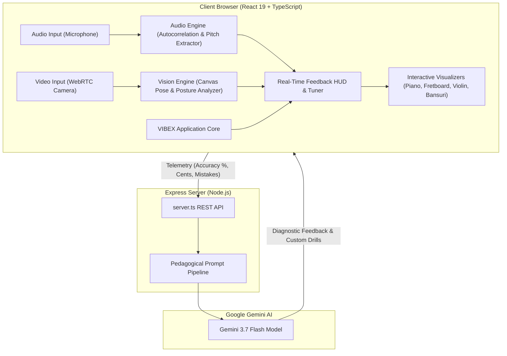

# 🎵 VIBEX — Smart AI Music Learning Platform

<div align="center">


**An AI-powered music mentor teaching Keyboard, Guitar, Violin, and Bansuri through real-time audio pitch/timing analysis, computer vision posture feedback, interactive instrument visualizations, and Gemini AI pedagogical coaching.**

[](https://react.dev/)
[](https://www.typescriptlang.org/)
[](https://vitejs.dev/)
[](https://tailwindcss.com/)
[](https://ai.google.dev/)
[](https://nodejs.org/)
[](LICENSE)
[](https://github.com/mrunal-g-ai/VIBEX/actions/workflows/ci.yml)

[Features](#-key-features) • [Instruments](#-supported-instruments) • [Architecture](#-system-architecture) • [Learning Modes](#-learning-modes--workflow) • [Tech Stack](#-tech-stack) • [API](#-rest-api-endpoints) • [Getting Started](#-getting-started)

</div>

---

## 🌟 Overview

**VIBEX** bridges the gap between self-taught music practice and private conservatory tutoring. Traditional apps only check whether a key was pressed; VIBEX listens to your acoustics, checks your body mechanics via camera vision, and provides real-time, encouraging guidance powered by Google Gemini AI.

Whether you're tuning your first acoustic guitar string, finding intonation on a fretless violin fingerboard, coordinating two-hand keyboard scales, or mastering Indian classical Bansuri swaras (*Sa, Re, Ga, Ma, Pa, Dha, Ni*), VIBEX provides instant, actionable feedback.

---

## 🚀 Key Features

### 🎧 1. Real-Time Audio Pitch & Rhythm Engine
- **In-Browser Pitch Detection**: Low-latency pitch tracking using Web Audio API autocorrelation and frequency estimation algorithms.
- **Tuner & Cents Precision**: Detects microtonal cents sharp/flat deviations in real time.
- **Rhythmic Timing & Metronome**: Built-in metronome with beat precision scoring and rhythmic onset evaluation.

### 👁️ 2. Computer Vision Posture & Technique Tracking
- **Camera-Based Posture Evaluation**: Analyzes hand placement, wrist curvature, and body posture directly in the browser via WebRTC.
- **Instrument-Specific Mechanics**:
  - **Guitar**: Thumb placement behind neck and fretting finger arch.
  - **Violin**: Bow-to-string angle and left wrist collapse warnings.
  - **Keyboard**: Flat finger alerts and forearm alignment.
  - **Bansuri**: Embouchure blowing angle and finger pad hole coverage checks.

### 🤖 3. Google Gemini AI Maestro
- **AI Performance Diagnosis**: Analyzes telemetry (pitch accuracy %, timing precision %, vision cues) to deliver human-like, encouraging musical feedback.
- **Interactive AI Teacher Chat**: Ask questions regarding music theory, fingerings, scales, or performance anxiety with tailored context.
- **Dynamic Micro-Exercise Generator**: Automatically builds tailored 4-bar drills targeting your exact bottleneck.

### 🎼 4. Interactive Instrument Visualizers & Animated Demos
- **Virtual Keyboard**: 88-key mapped piano visualization with finger numbering guides (1-5).
- **Interactive Guitar Fretboard**: Real-time fret markers, root notes, and scale patterns.
- **Violin Fingerboard**: Fretless tape markers with microtonal intonation guides.
- **Interactive Bansuri**: Realistic 6-hole Indian bamboo flute finger pad coverage simulator.
- **Animated Technique Demonstrations**: Visual finger-by-finger motion guides for proper articulation.

### 📚 5. Structured Curriculum & Song Arena
- **Multi-Level Curriculum**: Step-by-step progressive lessons from absolute beginner fundamentals to advanced repertoire.
- **Song Library & Practice**: Play along with guided notation, real-time score tracking, streak counters, and confetti celebrations.
- **User Progress & Analytics**: Daily practice goals, mastery ratings, and persistent streak tracking.

### 🎨 6. Elegant Multi-Theme Design
- Choose from 4 themes:
  - **Obsidian**: Sleek modern dark mode with neon accents.
  - **Zen**: Minimalist earth tones designed for focused practice.
  - **Arcade**: Retro synthwave aesthetic with vibrant game-like elements.
  - **Nordic**: Clean, calm Scandinavian palette.

---

## 🎼 Supported Instruments

VIBEX provides tailored pedagogical systems, custom visualizers, and physics-informed feedback for four distinct instruments:

| Instrument | Visualizer | Core Feedback Mechanics | Primary Notation System |
| :--- | :--- | :--- | :--- |
| **🎹 Keyboard (Piano)** | Interactive 88-Key Piano | Hand arch, 1–5 finger numbering, two-hand coordination | Standard Western notation & key map |
| **🎸 Guitar** | 6-String Dynamic Fretboard | Fretting finger arch, thumb behind neck, fret accuracy | Tablature, fret/string numbers & chord boxes |
| **🎻 Violin** | Fretless Fingerboard HUD | Microtonal pitch cents, straight bow angle, relaxed left wrist | Western notation & microtonal cents tuner |
| **🪈 Bansuri** | 6-Hole Bamboo Flute Simulator | Pad hole sealing, embouchure blowing angle, breath support | Indian Classical Swaras (*Sa Re Ga Ma*) & Western pitch |

---

### 🎹 1. Keyboard (Piano)

<p align="center">
  
</p>

*Master keyboard geography, natural hand arch, finger independence, and two-hand rhythmic synchrony.*

- **Interactive Visualizer**: Dynamic multi-octave piano interface highlighting active notes, root keys, scale patterns, and anatomical finger numbers (Thumb: 1, Index: 2, Middle: 3, Ring: 4, Pinky: 5).
- **Audio Feedback**: Instant acoustic pitch recognition matching key strikes, polyphonic chord detection, and note duration validation.
- **Computer Vision Posture HUD**: 
  - Detects **flat finger collapse** (warning when fingers lose their relaxed curved arch).
  - Monitors **wrist sagging** below key-bed level to prevent strain and tendonitis.
  - Checks **elbow-to-keyboard height** for ergonomic seated balance.
- **Curriculum Highlights**: Seating & Middle C orientation, C Major pentachord (C-D-E-F-G), thumb tuck arpeggios, two-hand counterpoint, and classical/pop chord progressions.

---

### 🎸 2. Acoustic & Electric Guitar

<p align="center">
  
</p>

*Develop clean fretting mechanics, fluid string transitions, and rhythmic strumming precision.*

- **Interactive Visualizer**: 6-string virtual fretboard with standard and alternate tunings (E-A-D-G-B-E), custom fret markers (3, 5, 7, 9, 12), active scale boxes, and finger markers (1=Index, 2=Middle, 3=Ring, 4=Pinky).
- **Audio Feedback**: Pitch detection for single-note clarity, fret buzz isolation, and string separation scoring for open & barre chords.
- **Computer Vision Posture HUD**:
  - Detects **fretting thumb positioning** (warns if thumb hooks too far over the neck instead of supporting behind the 2nd fret).
  - Analyzes **finger arch angle** to prevent accidental string muting.
  - Monitors **instrument body angle** and neck tilt relative to the player's torso.
- **Curriculum Highlights**: Standard tuning fundamentals, open chords (Em, C, G, D, Am), alternate pick stroke drills, the spider finger-independence exercise, and pentatonic blues soloing.

---

### 🎻 3. Violin

<p align="center">
  
</p>

*Conquer the fretless fingerboard with microtonal intonation precision and fluid bow mechanics.*

- **Interactive Visualizer**: Precision fretless fingerboard featuring standard 1st position tape guides, string indicators (G3, D4, A4, E5), and real-time cents intonation deviation meters.
- **Audio Feedback**: Microtonal intonation tracking within ±5 cents, overtone harmonic resonance detection, and continuous sustained note stability.
- **Computer Vision Posture HUD**:
  - Detects **"Pizza Wrist" (collapsed left wrist)** pressing against the neck.
  - Checks **bow stroke trajectory** (alerts if the bow drifts crookedly rather than staying perpendicular to the strings in the sounding lane).
  - Monitors **scroll elevation** (alerts if the violin scroll droops below horizontal level).
- **Curriculum Highlights**: Collarbone rest balance, the "bunny rabbit" bow grip, open string bow distribution (frog to tip), 1st position finger placements, slurred bow transitions, and expressive vibrato preparation.

---

### 🪈 4. Bansuri (Indian Classical Bamboo Flute)

<p align="center">
  
</p>

*Master Indian classical swaras, airtight finger pad sealing, and centered breath embouchure.*

- **Interactive Visualizer**: Realistic 6-hole north Indian bamboo flute simulator displaying open, closed, and half-shaded holes mapped to both Indian classical Swaras (*Sa, Re, Ga, Ma, Pa, Dha, Ni*) and Western pitch frequencies.
- **Audio Feedback**: Sustained tone purity analysis, breath stability evaluation, microtonal inflection scoring, and Komal (flat) / Teevra (sharp) half-hole pitch verification.
- **Computer Vision Posture HUD**:
  - Monitors **lip embouchure alignment** and angle against the blowing hole.
  - Verifies **flat finger pad coverage** (ensures players use finger pads rather than curved fingertips to seal large bamboo tone holes).
  - Checks **flute tilt angle** and relaxed shoulder posture.
- **Curriculum Highlights**: Sound generation and lip aperture, Mandra/Madhya/Taar Saptak octaves, fundamental *Saptak Swaras*, Alankars (palta speed drills), and traditional Raga ornamental techniques (*Meend* glide and *Murki*).

---

## 🏗️ System Architecture



---

## 🎮 Learning Modes & Workflow

VIBEX organizes music education into five interconnected modules:

| Mode | Purpose | Key Capabilities |
| :--- | :--- | :--- |
| 🚀 **Onboarding & Assessment** | Experience profiling | Sets instrument, skill baseline (Beginner/Intermediate), and daily practice target |
| 📖 **Structured Curriculum** | Step-by-step masterclasses | 12 progressive phases per instrument with theory, animated demos, and required pass scores |
| 🎯 **Practice & Tuner HUD** | Live drill rehearsal | Microtonal pitch detection, metronome tempo sync, and camera posture alerts |
| 🏆 **Song Arena** | Repertoire play-along | Interactive rolling sheet music, real-time note accuracy %, streaks, and confetti scores |
| 🤖 **AI Maestro Chat** | 24/7 Personal Tutor | In-depth theory Q&A, fingering tips, and automated adaptive drill generation |

---

## 🛠️ Tech Stack

### Frontend
- **Framework**: [React 19](https://react.dev/) + [TypeScript](https://www.typescriptlang.org/)
- **Bundler & Build Tool**: [Vite 6](https://vitejs.dev/)
- **Styling**: [Tailwind CSS v4](https://tailwindcss.com/)
- **Icons & Animations**: [Lucide React](https://lucide.dev/), [Motion](https://motion.dev/), [Canvas Confetti](https://www.npmjs.com/package/canvas-confetti)
- **Audio Processing**: Web Audio API (AudioContext, AnalyserNode, Autocorrelation algorithm)
- **Vision Processing**: HTML5 WebRTC Canvas video frame analysis

### Backend
- **Runtime**: [Node.js](https://nodejs.org/) with [Express](https://expressjs.com/)
- **Dev Runner**: [TSX](https://github.com/privatenumber/tsx) & [esbuild](https://esbuild.github.io/)
- **AI Model**: [Google Gen AI SDK (`@google/genai`)](https://www.npmjs.com/package/@google/genai) with `gemini-3.7-flash`

---

## 📦 Project Structure

```text
VIBEX/
├── assets/                     # Static media and assets
├── src/
│   ├── components/             # React UI components
│   │   ├── AIAvatarCoach.tsx             # Interactive avatar feedback
│   │   ├── AITeacherChat.tsx             # Gemini-powered Q&A chat
│   │   ├── AnimatedDemo.tsx              # Animated technique simulations
│   │   ├── AnimatedTechniqueDemonstration.tsx
│   │   ├── HandFingerNumberingFigure.tsx # Anatomical finger numbering
│   │   ├── InteractiveBansuri.tsx        # Flute hole coverage visualizer
│   │   ├── InteractiveFretboard.tsx      # Guitar fretboard visualizer
│   │   ├── InteractiveKeyboard.tsx       # Piano keyboard visualizer
│   │   ├── InteractiveViolinFingerboard.tsx # Violin intonation visualizer
│   │   ├── LearnCurriculumView.tsx       # Step-by-step curriculum UI
│   │   ├── OnboardingFlow.tsx            # Initial goal & level setup
│   │   ├── PracticeExerciseView.tsx      # Active drill & pitch practice
│   │   ├── RealtimeAudioVisionMonitor.tsx # Audio & camera feedback HUD
│   │   ├── SmartCorrectionModal.tsx      # AI post-drill diagnostic modal
│   │   ├── SongLibraryView.tsx           # Song catalog
│   │   ├── SongPracticeView.tsx          # Real-time song play-along arena
│   │   ├── ThemeSelectorModal.tsx        # UI theme picker
│   │   └── UserProfileStats.tsx          # Practice stats & streaks
│   ├── data/
│   │   ├── curriculum.ts                 # Full lesson plans & exercise drills
│   │   └── songs.ts                      # Song library notes & tablatures
│   ├── services/
│   │   ├── audioEngine.ts                # Pitch detection, tuner, metronome
│   │   └── visionEngine.ts               # Camera posture & hand tracking
│   ├── types/
│   │   └── index.ts                      # Shared TypeScript interfaces
│   ├── App.tsx                           # Main application component
│   ├── index.css                         # Tailwind CSS & global styles
│   └── main.tsx                          # React entrypoint
├── index.html                  # HTML entry template
├── metadata.json               # App metadata
├── package.json                # Dependencies and scripts
├── server.ts                   # Express server with Gemini API routes
├── tsconfig.json               # TypeScript compiler config
├── vite.config.ts              # Vite configuration
└── .env.example                # Example environment variables
```

---

## 🚦 Getting Started

### Prerequisites
- [Node.js](https://nodejs.org/) (version 18 or higher recommended)
- [npm](https://www.npmjs.com/) or [bun](https://bun.sh/)
- A [Google Gemini API Key](https://aistudio.google.com/app/apikey) (Optional for AI mentoring; audio/visual drills work standalone with built-in fallbacks)

### Installation

1. **Clone the repository**:
   ```bash
   git clone https://github.com/mrunal-g-ai/VIBEX.git
   cd VIBEX
   ```

2. **Install dependencies**:
   ```bash
   npm install
   ```

3. **Configure Environment Variables**:
   Create a `.env` file from `.env.example`:
   ```bash
   cp .env.example .env
   ```
   Open `.env` and add your Gemini API key:
   ```env
   GEMINI_API_KEY="your_actual_gemini_api_key_here"
   PORT=5000
   ```

4. **Start the Development Server**:
   ```bash
   npm run dev
   ```
   Open your browser and navigate to `http://localhost:5000`.

---

## ⚙️ Available Scripts

| Command | Description |
| :--- | :--- |
| `npm run dev` | Starts the Express server with Vite middleware using `tsx` |
| `npm run build` | Builds the client via `vite build` and bundles `server.ts` with `esbuild` |
| `npm run start` | Runs the production bundle from `dist/server.cjs` |
| `npm run lint` | Runs TypeScript compiler checks without emitting files |
| `npm run preview` | Previews the Vite production build locally |
| `npm run clean` | Cleans the `dist` folder |

---

## 🔐 Environment Variables

| Variable | Required | Description |
| :--- | :---: | :--- |
| `GEMINI_API_KEY` | Optional* | Google Gemini API key for AI mentor chat and dynamic exercises |
| `PORT` | Optional | Port for the Express server (defaults to `5000`) |
| `APP_URL` | Optional | Hosted application URL for cloud deployments |

*\*If no API key is provided, VIBEX gracefully falls back to built-in pedagogical heuristics so you can still practice.*

---

## 🔌 REST API Endpoints

The backend Express server (`server.ts`) exposes specialized music pedagogy endpoints:

| Method | Endpoint | Description | Request Body Payload |
| :--- | :--- | :--- | :--- |
| `GET` | `/api/health` | Backend health & uptime check | None |
| `POST` | `/api/ai/mentor-advice` | Analyzes telemetry to deliver personalized coaching | `{ instrument, experienceLevel, audioAccuracy, rhythmAccuracy, visionMistakes, recentNotes }` |
| `POST` | `/api/ai/chat` | Interactive conversation with the AI Music Mentor | `{ message, instrument, userContext }` |
| `POST` | `/api/ai/generate-exercise` | Dynamically creates custom drills targeting weak skills | `{ instrument, weakSkill, level }` |

---

## 🛡️ Permissions Note

VIBEX runs completely client-side for audio and vision monitoring:
- **Microphone**: Needed for real-time pitch detection, tuner, and note duration analysis.
- **Camera**: Needed for posture and hand position monitoring.
- *No audio or camera streams are recorded or stored on any external server.*

---

## 🤝 Contributing

Contributions are welcome! To contribute:

1. Fork the Project
2. Create your Feature Branch (`git checkout -b feature/AmazingFeature`)
3. Commit your Changes (`git commit -m 'Add some AmazingFeature'`)
4. Push to the Branch (`git push origin feature/AmazingFeature`)
5. Open a Pull Request

---

## 📄 License

Distributed under the Apache License 2.0. See [LICENSE](LICENSE) for more information.

<div align="center">
Made with ❤️ for musicians and learners everywhere.
</div>
